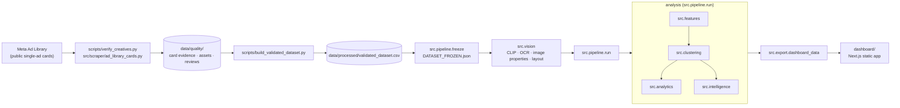

# AdVision AI — Meta Ads Creative Intelligence

AdVision AI collects public Meta Ad Library ads for five Indian D2C wellness brands (Kapiva,
OZiva, Mamaearth, Himalaya Wellness, MuscleBlaze). It verifies every ad against its exact live
Ad Library card, recovers each ad's own creative, and builds an evidence-backed dataset.
On that frozen dataset it extracts visual features (CLIP embeddings, OCR text density, colour,
layout), clusters the creatives, and publishes traceable observations to a static
Next.js dashboard.

> **Status (frozen run, 2026-11-13 16:13 IST)**
> - Validated dataset **frozen**: sha256 `398567d57f2e2c47e64b28806cabe041e2d9758b6769b194ea98685f6479aa7f`,
>   **50 VERIFIED ads**: Kapiva 10 · OZiva 10 · Mamaearth 10 · Himalaya Wellness 10 · MuscleBlaze 10. **0 unresolved.**
>   29 are legacy records retained after live verification; 21 are verified same-brand replacements.
>   Details: [`reports/dataset_validation_report.md`](reports/dataset_validation_report.md).
> - Feature extraction is complete for 50/50 (CLIP, OCR, image features); clustering, analytics and observations ran on
>   the frozen dataset (`data/outputs/run_manifest.json`, provisional = false). The dashboard export carries the same fingerprint.

## Results (frozen run)

Every number is an OBSERVATION read from the outputs; interpretations are in the linked reports, marked as hypotheses. n = 50, so treat it as exploratory.

- **Clustering:** agglomerative, average-linkage cosine on CLIP embeddings, k = 8. Silhouette 0.169 (weak
  separation), Davies–Bouldin 2.03, subsample-stability ARI 0.90, no noise. k = 8 is the upper bound of the searched
  grid (2–8). The fused-feature variant selects k = 7 and agrees with ARI 0.69. See [`reports/clustering_evaluation_report.md`](reports/clustering_evaluation_report.md).
- **Clusters follow brand:** size-weighted brand purity is 90%, and 5 of 8 clusters are single-brand (e.g. cluster 6 = all 10
  MuscleBlaze ads; cluster 3 = all 10 Himalaya Wellness ads plus 2 Mamaearth). Within-brand CLIP similarity exceeds cross-brand
  similarity for every brand; it is highest for Himalaya Wellness (0.618 vs 0.389).
- **On-image offer wording** (OCR): Himalaya Wellness 9/10 and MuscleBlaze 8/10, against Kapiva 2/10 and Mamaearth 2/10 (dataset 52%).
- **Colour:** MuscleBlaze is the only brand whose largest colour family is black/grey (49% of pixels). Kapiva has the most
  consistent palette (mean pairwise colour distance 0.360 vs 0.554 overall).
- **Text density** (median share of image area covered by text): from 0.094 (Mamaearth) to 0.145 (MuscleBlaze); dataset 0.129.

Reports: [`brand_comparison_report.md`](reports/brand_comparison_report.md) ·
[`creative_intelligence_report.md`](reports/creative_intelligence_report.md) · demo script in
[`docs/demo_guide.md`](docs/demo_guide.md). These describe creative appearance only; nothing here
measures or implies ad performance.

---

## Contents
1. [Problem and approach](#1-problem-and-approach)
2. [Architecture](#2-architecture)
3. [Repository structure](#3-repository-structure)
4. [Tech stack](#4-tech-stack)
5. [Setup](#5-setup)
6. [Running the project](#6-running-the-project)
7. [Outputs](#7-outputs)
8. [Methodology](#8-methodology)
9. [Testing](#9-testing)
10. [Limitations](#10-limitations)
11. [Ethics and platform compliance](#11-ethics-and-platform-compliance)
12. [Legacy artefacts](#12-legacy-artefacts)

---

## 1. Problem and approach

Competitive creative analysis needs the *actual* creative behind each ad. The Meta Ad Library
has no commercial-ads API for India, and naive scraping is easy to get wrong. This project's
first collection pass captured page screenshots from generic result pages. As a result, many
"creatives" belonged to neighbouring cards or to other advertisers entirely (IHG Hotels, Nykaa,
Snapmint, …). See [`reports/creative_quality_audit.md`](reports/creative_quality_audit.md).

The current pipeline treats the live **single-ad Ad Library card as ground truth**:

1. **Verify:** open each ad's own public card, read the advertiser and metadata shown on it, and
   check the advertiser against an allowlist of official brand pages.
2. **Recover:** download the card's own creative asset as served (no screenshot, crop or upscale)
   and record its source URL, dimensions, SHA-256 and timestamp.
3. **Curate:** apply objective quality gates and a recorded visual review, remove exact and
   perceptual duplicates, replace failures with verified same-brand ads, and **freeze** the dataset by hash.
4. **Analyse:** CLIP / OCR / image features → fused feature matrix → clustering sweep with a
   multi-criteria selection → figures and traceable observations → dashboard export.

## 2. Architecture



More detail is in [`docs/architecture.md`](docs/architecture.md). Interfaces between modules are
fixed by [`docs/analysis_data_contract.md`](docs/analysis_data_contract.md) and
[`docs/dashboard_data_contract.md`](docs/dashboard_data_contract.md).

## 3. Repository structure

```
.
├── README.md · Makefile · pyproject.toml · requirements.txt · requirements-dev.txt · .env.example
├── config/
│   ├── settings.py              paths, brands, official-advertiser allowlist, brand aliases, vision settings
│   └── analysis_pipeline.json   analysis pipeline configuration
├── src/
│   ├── scraper/                 browser lifecycle, live-card verification (ad_library_cards.py), parsing helpers
│   ├── quality/                 image metrics, perceptual hashing, contact sheets
│   ├── vision/                  preprocessing, image properties, CLIP embeddings, OCR, layout labels, feature CLI
│   ├── features/                feature bundle loading/validation, normalisation, fusion
│   ├── clustering/              K-Means / Agglomerative / HDBSCAN, metrics, stability, selection
│   ├── analytics/               figures with per-mark ad-ID manifests
│   ├── intelligence/            templated, traceable observations; cluster profiles
│   ├── export/                  dashboard data export
│   ├── pipeline/                end-to-end runner (run.py) and dataset freeze (freeze.py)
│   └── utils/                   logging setup
├── scripts/                     CLIs for collection and dataset curation (see scripts/README.md)
├── tests/                       pytest suite (unit + integration on real verified creatives)
├── dashboard/                   Next.js 14 frontend (separate toolchain)
├── data/
│   ├── raw/                     immutable legacy scrape
│   ├── legacy/                  legacy dataset + legacy creatives (superseded, audit only)
│   ├── quality/                 verification evidence: live cards, staged assets, reviews, audit CSV/JSON
│   ├── creatives/verified/      verified creative assets  <brand>/<ad_id>.<ext>
│   ├── processed/               validated dataset, freeze marker, visual features, CLIP embeddings
│   ├── outputs/                 generated analysis outputs (gitignored)
│   └── archive/                 dated evidence snapshots with SHA-256 manifests (gitignored)
├── docs/                        methodology, contracts, architecture, design, demo guide
├── reports/                     generated audit, progress and brand reports; contact sheets
└── legacy/                      superseded code, tests and reports kept for audit
```

## 4. Tech stack

| Area | Tools |
|---|---|
| Collection | Python 3.11, Playwright 1.60.0 (headless Chromium), public Ad Library pages only |
| Image features | Pillow, NumPy, OpenCV (headless) |
| Embeddings | PyTorch (CPU / Apple MPS), open_clip ViT-B-32 `laion2b_s34b_b79k` (512-d) |
| OCR | RapidOCR on ONNX Runtime (no Tesseract binary) |
| Clustering and analytics | scikit-learn (K-Means, Agglomerative, HDBSCAN, metrics, PCA), Matplotlib (Agg) |
| Dashboard | Next.js 14.2.35, React 18.3.1, TypeScript 5.6.3, Tailwind CSS 3.4.14, Recharts 2.12.7, Vitest 2.1.4 |
| Quality | pytest, ruff, ESLint, `tsc --noEmit` |

## 5. Setup

Prerequisites: Python 3.11, Node.js 18+ (dashboard only), about 2 GB of free disk (Python
environment plus a ~1.1 GB Hugging Face cache for the CLIP weights, downloaded on first use).

```bash
make setup        # creates .venv, installs requirements-dev.txt, installs Chromium for Playwright
cp .env.example .env   # optional; every variable has a default
```

CPU is the default device, for bit-reproducible embeddings. Set `ADVISION_CLIP_DEVICE=mps` to
use the Apple Silicon GPU. No CUDA is required.

## 6. Running the project

| Command | What it does | Network |
|---|---|---|
| `make verify` | Re-verify the legacy ad IDs against their live cards (2 polite workers; stops on throttling) | yes |
| `make dataset` | Build `validated_dataset.{csv,json}` + quality reports from the recorded evidence | no |
| `make freeze` | Freeze the dataset by SHA-256. Refuses if any acceptance or integrity check fails | no |
| `make features` | CLIP + OCR + image features for `final_status=VERIFIED` ads | first run downloads CLIP |
| `make validate-features` | Check the feature outputs map 1:1 to the dataset | no |
| `make analyze` | features → clustering → analytics → intelligence → report. Needs a frozen dataset | no |
| `make dashboard-data` | Export analysis outputs to `dashboard/public/data/` | no |
| `make dashboard` | Run the dashboard locally | npm install |
| `make test` / `make lint` | Python test suite / ruff | no |

`python -m src.pipeline.run --allow-provisional` runs the analysis on an unfrozen dataset for
development. Everything it produces goes to `data/outputs/provisional/` and is stamped PROVISIONAL.
Per-script details are in [`scripts/README.md`](scripts/README.md).

## 7. Outputs

| Path | Producer | Content |
|---|---|---|
| `data/quality/live_cards.json`, `replacement_cards.json`, `muscleblaze_recapture_cards.json` | `scripts/verify_creatives.py` | Per-ad live-card evidence (advertiser, copy, CTA, dates, landing URL, asset URL, hash) |
| `data/quality/visual_review.json` | lead reviewer | Recorded visual decisions + reasons |
| `data/quality/advertiser_verification.csv`, `image_quality_report.csv`, `duplicate_groups.json`, `recovery_manifest.csv`, `replacement_mapping.csv`, `dataset_integrity_report.json` | `scripts/build_validated_dataset.py` | Audit trail |
| `data/creatives/verified/<brand>/<ad_id>.<ext>` | same | Byte copies of verified assets |
| `data/processed/validated_dataset.{csv,json}` | same | All legacy rows (traceability) + selected replacements, with five status fields and `final_status` |
| `data/processed/DATASET_FROZEN.json` | `make freeze` | Dataset hash and freeze time |
| `data/processed/visual_features.json`, `clip_embeddings.npy` | `make features` | One feature record per VERIFIED ad + L2-normalised 512-d vectors |
| `data/outputs/{features,clustering,analytics,intelligence}/<variant>/`, `run_manifest.json` | `make analyze` | Matrices, sweep + selection, figures + ad-ID manifests, observations |
| `reports/analysis_run_report.md` | `make analyze` | Run summary |
| `dashboard/public/data/` | `make dashboard-data` | Dashboard JSON + creative copies |
| `reports/*.md`, `reports/creative_contact_sheets/` | `scripts/generate_quality_reports.py`, brand reports | Human-readable audits |

## 8. Methodology

**Data collection.** Each ad is opened at
`/ads/library/?active_status=all&ad_type=all&country=IN&id=<ad_id>&media_type=all`. The card whose
text is exactly `Library ID: <ad_id>` is isolated, and its advertiser, copy, CTA, dates and
landing URL are read from it. Its own `` (or `<video>` poster) is downloaded as served.
The legacy pipeline used the bare `?id=<ad_id>` URL. That loads a generic results page instead of the ad,
which is the root cause of its wrong images.

Requests are sequential per worker, with multi-second settle times. A run stops automatically
after three consecutive pages with zero ad cards (throttling) or a login wall, and it resumes only
after a cool-down with one control request. Notes on the access investigation (API restrictions,
direct HTTP blocked): [`docs/data_collection_access_notes.md`](docs/data_collection_access_notes.md).

**Dataset acceptance.** A record is `VERIFIED` only if all five checks pass:
- the advertiser is an allowlisted official page or a partnership ad naming it;
- the image came from that exact card;
- the metadata came from the same card;
- the image passes quality (longest side ≥ 600 px, sharpness ≥ 100, contrast ≥ 0.05) plus a recorded visual review;
- the record is not a duplicate (SHA-256 / 64-bit dHash).

Failed legacy records are replaced with verified same-brand ads and never padded.
See [`reports/creative_quality_audit.md`](reports/creative_quality_audit.md) and
[`reports/dataset_validation_report.md`](reports/dataset_validation_report.md).

**Feature extraction.** Image properties (size, orientation, brightness, contrast, Laplacian
sharpness, colourfulness, k-means dominant colours, hue distribution); CLIP ViT-B-32
embeddings of the letterboxed creative; RapidOCR text, text density (union of text boxes ÷
area) and placement; rule-based layout labels with their triggering cues. See the
[feature engineering audit](docs/feature_engineering_audit.md).

**Clustering evaluation.** The pipeline sweeps K-Means, Agglomerative (Ward / average-cosine)
and HDBSCAN, where noise stays unassigned. Selection ranks configurations on silhouette,
Davies–Bouldin, Calinski–Harabasz and seed/subsample stability (ARI). It penalises tiny clusters,
excessive noise and giant clusters, and never selects on one metric. See
[`docs/clustering_methodology.md`](docs/clustering_methodology.md),
[`docs/visual_analytics_specification.md`](docs/visual_analytics_specification.md) and
[`docs/creative_intelligence_methodology.md`](docs/creative_intelligence_methodology.md).

## 9. Testing

```bash
make test                         # Python suite (108 tests collected); integration tests use real verified creatives
make lint                         # ruff
cd dashboard && npm run lint && npx tsc --noEmit && npm test && npm run build
```

Unit tests use synthetic, explicitly labelled vectors and images. End-to-end tests (`tests/test_pipeline.py`,
`tests/test_export.py`) run every stage on a small subset of real verified creatives in a temporary
directory. They also run the dashboard's TypeScript validators against a real export.

## 10. Limitations

- **Sample size.** About 10 ads per brand. Clusters and observations are descriptive and
  exploratory, not statistically general.
- **Resolution.** The Ad Library serves static creatives at a 600 px longest side, so portrait creatives
  are below 600 px on the short side. Nothing is upscaled.
- **OCR.** Devanagari text is detected (it counts toward text density) but usually not transcribed,
  and the `₹` glyph is often dropped.
- **Layout labels** are transparent heuristics that haven't been validated against human labels.
- **Snapshot.** Ads are captured at one point in time. Multi-version ads show the version served at capture.
- **Rate limiting.** Replacement discovery is throttled by Meta. Open slots stay open rather than
  being filled with unverified data.
- **No performance data.** Creative appearance says nothing about spend, reach or effectiveness, and
  the project makes no such claims.

## 11. Ethics and platform compliance

- The project uses only the public, logged-out Meta Ad Library, which Meta publishes for
  transparency. There's no login, no CAPTCHA solving, no private APIs and no rate-limit evasion,
  and runs stop on throttling.
- Traffic is low and polite: sequential requests, multi-second delays, cool-downs.
- The data covers brand advertising only. Creator names appear only where Meta labels a
  partnership ad, and no personal data is collected.
- Creatives remain the property of their advertisers. They are stored for non-commercial research
  and analysis, and are not redistributed.

## 12. Legacy artefacts

The first collection pass produced a dataset whose images and metadata were often mismatched.
Its code, tests and reports are kept for audit in [`legacy/`](legacy/README.md). Its data is in
`data/raw/` and `data/legacy/`, and a hashed snapshot is in `data/archive/evidence_2026-11-13/`.
None of it is used by the current pipeline.
